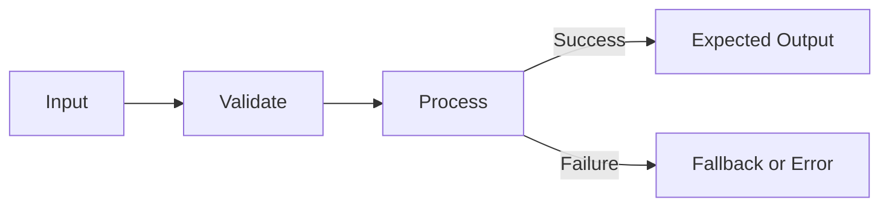

# SPEC-TEMPLATE

本模板用于描述需要修改 production code 的新功能、行为变更、缺陷修复、性能优化或技术调整。目标是让实现者明确知道为什么改、必须如何表现、哪些地方不能改，以及如何验证完成。

## 使用规则

- 按 `AGENTS.md` 的命名规则复制到对应的 `specs/` 目录后填写，不直接在本模板中记录具体需求。
- Spec 是对应需求的任务、验收标准、验证结果和剩余工作的唯一进度来源。
- 删除确实不适用的小节，不保留空占位；目标行为、影响范围、测试计划、任务进度和验证结果不得省略。
- 已经发布或已生成的历史设计不需要为了匹配新模板而回填。
- 不要写入真实 token、secret、访问密钥、用户隐私数据或敏感业务原文。

---

# {{Feature / Change / Bugfix Name}} {{Spec / Change / Bugfix}}

## 1. 背景与目标

说明本次工作要解决的问题及其价值：

- 背景：{{当前上下文和问题来源}}
- 目标：{{完成后用户或调用方能够观察到的结果}}
- 类型：{{新功能 / 行为变更 / 缺陷修复 / 性能优化 / 技术调整 / 历史需求补录}}
- 成功标准：{{可验证、可判断完成与否的结果}}
- 已确认结论：{{结论、确认人和日期；没有则删除}}

## 2. 当前行为

新功能没有既有行为时可说明“无”；修改既有行为时必须给出真实入口和问题证据。

| 位置或入口 | 当前行为 | 当前问题 |
| --- | --- | --- |
| `path/to/file.ext::symbol` | {{当前如何处理输入或输出}} | {{为什么不满足目标}} |

必要时补充当前输入、输出、截图、日志或复现步骤。示例必须脱敏。

## 3. 目标行为与验收标准

先用“必须 / 禁止 / 保持不变”固定行为：

- 必须：{{命中场景}} 时，系统执行 {{目标行为}}。
- 必须：{{异常或未命中场景}} 时，系统执行 {{fallback / skip / error}}。
- 禁止：{{不允许出现的旧行为或副作用}}。
- 保持不变：{{兼容行为、既有数据或不受影响的用户路径}}。

再将关键行为写成可执行验收场景：

| 场景 | 前置条件 | 操作或输入 | 期望结果 |
| --- | --- | --- | --- |
| 正常路径 | {{condition}} | `{{input}}` | {{observable result}} |
| 边界路径 | {{condition}} | `{{input}}` | {{observable result}} |
| 失败路径 | {{condition}} | `{{input}}` | {{error or fallback}} |

## 4. 影响范围与非目标

### 影响范围

| 模块 | 路径 | 改动类型 | 说明 |
| --- | --- | --- | --- |
| {{module}} | `path/to/module` | 新增 / 修改 / 删除 | {{本次改动}} |
| {{tests}} | `path/to/tests` | 新增 / 修改 | {{验证行为}} |

### 非目标 / 不改范围

- 不修改：{{不受影响的模块或用户路径}}。
- 不新增：{{本次不需要的接口、依赖、数据结构或配置}}。
- 不处理：{{明确推迟到后续需求的事项}}。
- 不进行：{{无关重构、格式化、重命名或依赖升级}}。

## 5. 核心实现契约

接口包含调用方正确使用实现所需知道的全部事实，包括输入输出、约束、错误模式、配置和性能要求。

| 变更点 | 位置 | 输入 | 必须行为 | 输出 | 错误或 fallback | 禁止行为 |
| --- | --- | --- | --- | --- | --- | --- |
| {{change point}} | `path/to/file.ext::symbol` | {{input}} | {{rule}} | {{output}} | {{failure behavior}} | {{forbidden behavior}} |

### 公开接口、类型与兼容性

- 新增或修改的公开接口：{{none / details}}
- 新增或修改的数据结构：{{none / details}}
- 持久化或迁移要求：{{none / details}}
- 向后兼容要求：{{none / details}}
- 性能或资源约束：{{none / details}}

## 6. 输入输出样例

| 场景 | 输入 | 期望输出 |
| --- | --- | --- |
| 正常命中 | `{{input}}` | `{{output}}` |
| 未命中 | `{{input}}` | {{fallback / empty / error}} |
| 空值 | `{{input}}` | {{fallback / empty / error}} |
| 非法格式 | `{{input}}` | {{fallback / error / skip}} |
| 历史兼容 | `{{input}}` | {{new compatible behavior}} |

## 7. 调用链路 / 数据流

只有关系不容易用文字说明时才保留本节。小变更使用一张 Mermaid flowchart；复杂跨模块流程才使用 sequence diagram。

- 入口：`{{entry point}}`
- 主要处理模块：`{{module}}`
- 输出消费者：`{{caller / UI / storage}}`
- 是否改变既有消费语义：{{否 / 是，说明原因}}

## 8. 测试计划与验收标准

测试必须验证公开行为，不绑定私有实现细节。代码改动按一个行为一个切片执行 RED、GREEN、REFACTOR。

| 行为或风险 | 测试层级 | RED 失败原因 | 验证命令 | 期望结果 |
| --- | --- | --- | --- | --- |
| {{critical behavior}} | 单元 / 集成 / UI / 契约 | {{why it should fail first}} | `{{command}}` | {{passing evidence}} |
| {{edge or failure behavior}} | {{level}} | {{failure reason}} | `{{command}}` | {{passing evidence}} |

- 聚焦测试：`{{command}}`
- 受影响范围测试：`{{command}}`
- 静态检查或构建：`{{command}}`
- 增量覆盖率命令与口径：`{{command and scope}}`
- 覆盖率门禁：至少 70%；如不适用或无法计算，记录原因、风险和替代证据。

## 9. Implementation Plan 与任务进度

每个 task 必须小而独立、可验证，并保持项目处于可运行状态。复制下方结构为每个 task 建立独立小节。

### Task {{N}}：{{task name}}

- 状态：`pending` / `in_progress` / `completed` / `blocked`
- 要构建什么：{{observable slice}}
- 为什么需要：{{relationship to acceptance criteria}}
- 修改文件：`{{paths}}`
- 精确改动：{{interface and implementation changes}}
- RED：{{test and intended failure}}
- GREEN：{{minimum implementation and focused test}}
- 广泛验证：{{broader tests, analyze, build or runtime check}}
- 期望结果：{{evidence}}
- 完成标准：{{task-specific acceptance criteria}}

### 9.1 当前进度

- 当前 task：{{task number and name / none}}
- 已完成：{{completed tasks / none}}
- 剩余工作：{{remaining tasks / none}}
- 阻塞或等待用户：{{reason and required action / none}}
- 下一个推荐 task：{{task number and name / none}}

## 10. 上线与回滚

- 发布或启用方式：{{app release / staged rollout / feature flag / local-only / not applicable}}
- 上线前检查：{{tests, build, migration, permissions, assets or compatibility checks}}
- 观察信号：{{user-visible failures, logs, metrics, crash or performance indicators}}
- 回滚触发条件：{{specific failure threshold or unacceptable behavior}}
- 回滚操作：{{revert, disable, restore data or previous artifact}}
- 数据恢复要求：{{none / details}}

## 11. 验证结果

每完成一个 task 后追加真实证据，不要预填为通过。

| 日期 | Task | 命令或验证方式 | 结果 | 覆盖率口径 | 备注 |
| --- | --- | --- | --- | --- | --- |
| {{YYYY-MM-DD}} | {{task}} | `{{command}}` | PASS / FAIL / BLOCKED | {{percentage and scope / N/A}} | {{evidence or risk}} |

## 12. 变更记录

| 日期 | 变更内容 | 原因 | 受影响的验收标准 | 确认人 |
| --- | --- | --- | --- | --- |
| {{YYYY-MM-DD}} | {{change}} | {{reason}} | {{criteria / none}} | {{user / role}} |

## 13. Checklist

- [ ] 已明确背景、目标和成功标准。
- [ ] 已描述当前行为、目标行为和关键验收场景。
- [ ] 已写明影响范围和非目标。
- [ ] 已固定公开接口、输入输出、错误处理和兼容要求。
- [ ] 已将 implementation plan 拆成可独立验证的 task。
- [ ] 已为关键路径、边界和失败路径安排测试。
- [ ] 已给出覆盖率口径、上线检查和回滚方法。
- [ ] 当前进度、验证结果、剩余工作和下一个推荐 task 保持准确。
- [ ] 未包含 secret、token、隐私数据或敏感业务原文。
